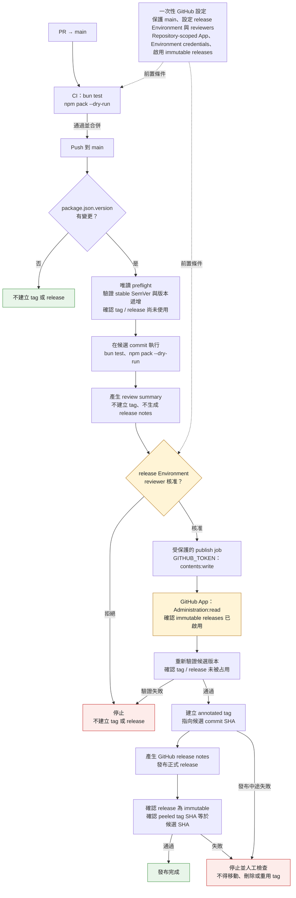

# GitHub CI/CD Workflow

## 目前尚待 GitHub owner 設定

- `main` branch protection：要求 PR 與 CI，禁止直接推送。
- `release` Environment：設定 required reviewers 與 self-review prevention。
- Repository-scoped GitHub App：僅授予 `Administration: read`，並在 Environment 設定 App credentials。
- 確認 immutable releases 已啟用。

本機 workflow 與程式尚未推送；GitHub Actions 實際執行與 reviewer gate 尚未驗證。
